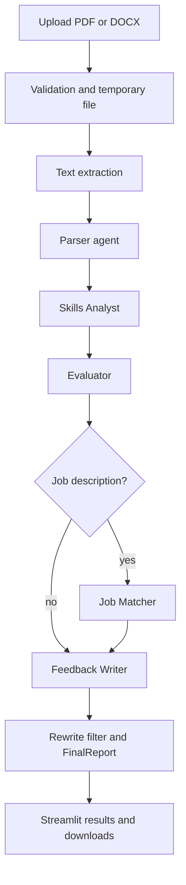
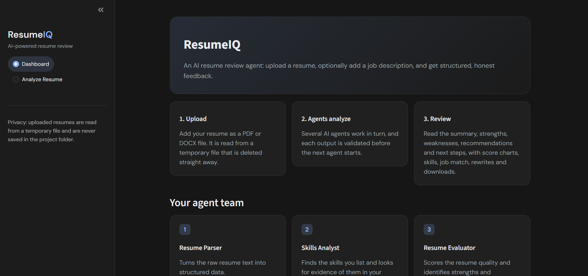
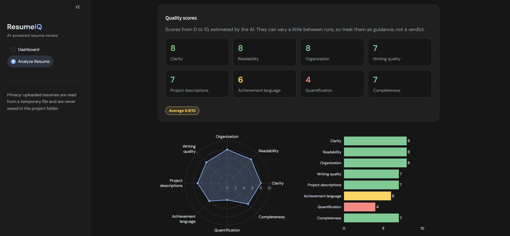

# ResumeIQ

An AI-powered resume review app built with CrewAI and Streamlit. Upload a resume, optionally add a job description, and get structured, honest feedback from a team of AI agents.

## What it does and the problem it solves

Job seekers get vague advice about their resumes. ResumeIQ reviews a resume in several focused steps and shows the result as scores, skills evidence, job-match details, before/after bullet rewrites and downloadable reports. Rewrites that add numbers not found in the resume are dropped.

## Why it is agentic AI

Instead of one big prompt, separate agents each own one job, work in sequence, and hand over structured output. Each output is validated with Pydantic before the next agent starts, and some data (skills, scores, job match) is copied by our code rather than rewritten by the AI.

## How CrewAI orchestrates the agents

The agents and tasks are defined with CrewAI and run sequentially. The analysis service runs each stage, validates the result, and retries a stage once if the model returns malformed output.

| Agent | Job |
|---|---|
| Resume Parser | Turns raw resume text into structured data |
| Skills Analyst | Finds skills and checks for evidence of use |
| Resume Evaluator | Scores quality (8 scores, 0 to 10) and lists strengths and improvements |
| Job Matcher | Compares the resume to a job description (only when one is given) |
| Feedback Writer | Writes the summary, recommendations, next steps and bullet rewrites (words only) |

## Architecture



More detail is in `docs/architecture.md`.

## Screenshots





## Technologies

Python 3.12, CrewAI, Google Gemini (free tier), Pydantic, Streamlit, Plotly, PyMuPDF, python-docx, pytest.

## Project structure

```
app.py              Streamlit entry point
agents/             CrewAI agent definitions
tasks/              CrewAI task definitions
services/           Document parser, LLM config, analysis and report services
backend/schemas.py  Pydantic models and output validation
ui/                 Styles, components, pages, charts, views, export, validation
tests/              Test suite (LLM mocked)
docs/               Development log, architecture, screenshots
```

## Installation (Windows, VS Code, PowerShell)

```powershell
cd C:\Projects\ResumeIQ
python -m venv .venv
.\.venv\Scripts\Activate.ps1
python -m pip install -r requirements.txt
```

## Environment variables

Copy `.env.example` to `.env` and set `LLM_PROVIDER`, `LLM_API_KEY` and `LLM_MODEL`. Never commit or share `.env`.

## Run the app

```powershell
streamlit run app.py
```

## Run the tests

```powershell
python -m pytest -q
```

The tests mock the LLM, so they use no API requests.

## How to use

1. Open **Analyze Resume**.
2. Upload a PDF or DOCX resume (max 5 MB).
3. Optionally paste a job description.
4. Click **Run analysis** and wait about a minute.
5. Read the results and download the Markdown or JSON report.

A full analysis uses 4 to 5 requests of the free-tier quota.

## Privacy and security

- Uploaded resumes are read from a temporary file that is deleted immediately. Nothing is stored in the project folder, and results are kept only in the browser session.
- Free-tier Gemini may use inputs to improve its models. Use only synthetic resumes or your own resume.
- Downloaded reports contain resume content and are saved only where you choose.
- `.env`, `.venv`, `.crewai/` and personal resumes must never be committed.

## Current limitations

- The rewrite filter checks invented numbers only, not other invented claims. Read every rewrite and use only what is true.
- Rewrites can contain placeholders such as "[add real number if you have one]".
- Scores and wording vary slightly between runs.
- Scanned-image PDFs have no extractable text and are not supported.
- The AI analysis is one long step, so progress shows three steps, not one per agent.
- Results are not saved after the page closes.

## Future improvements

OCR for scanned PDFs, a check for invented non-numeric claims, per-agent progress, saved history, and PDF report export.